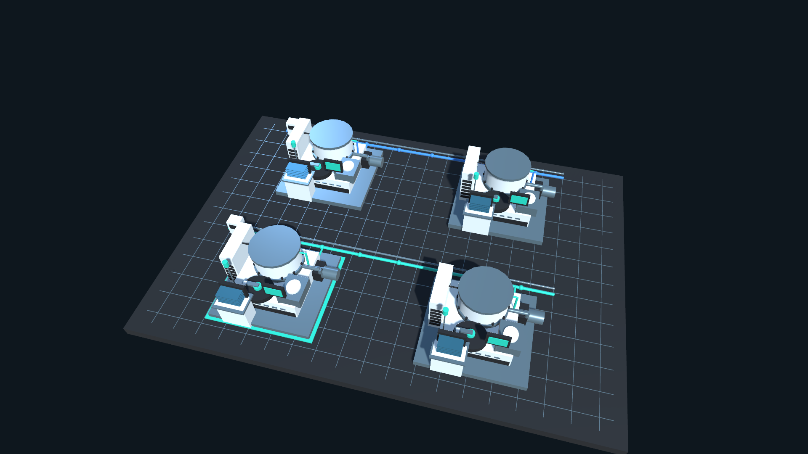
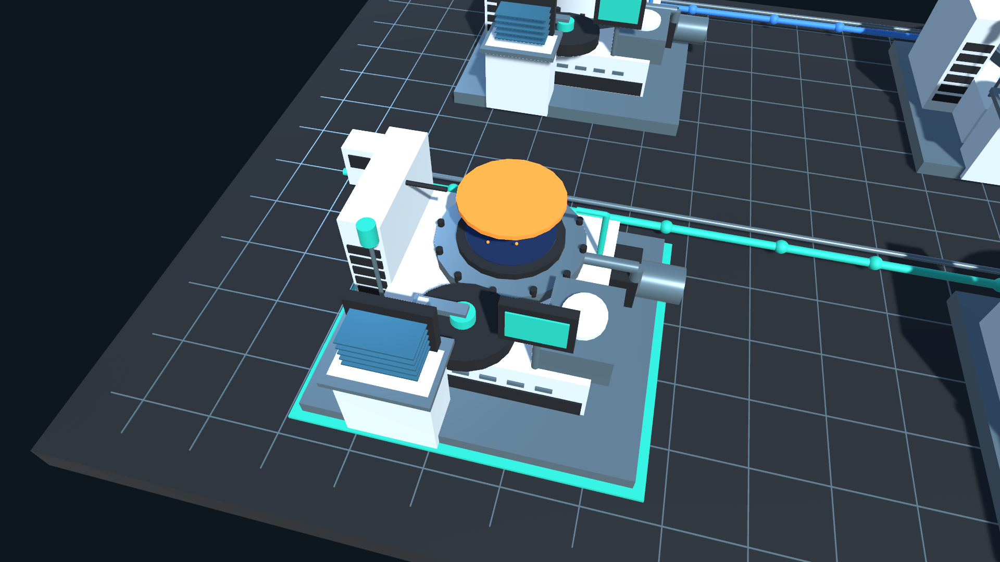

# 薄膜 PVD 多機台警報應變與復機模擬器

**PVD Multi-Tool Alarm Response Simulator**

**SIMULATED：通用設備概念與應變練習。非台積電或設備商正式系統、內部 SOP、真機配方或安全控制器。**

四台獨立設備、兩個完整情境、約三分鐘導覽與可自行操作的練習模式。重點是多台 Alarm 時確認風險、分工與分階段復機。所有數值、門檻、支援時間與權限都是教學設定。

**目前交付狀態：完整 Unity 專案與 Windows x64 成品已建立。17 項核心檢查、Unity EditMode 3/3、Windows batch 執行 A／B 情境與匯出均通過。已取得 18 張實際 3D 離屏渲染圖。依使用者要求採 batch mode，完整 UI 排版、滑鼠點擊與音訊仍待互動驗證；3D-only 圖片不代表完整遊戲畫面已驗證。**

## 啟動 Windows 成品

**免安裝下載：**前往 [GitHub Releases](https://github.com/ErenYagar/pvd-multi-tool-alarm-response-simulator/releases/tag/v0.1.0)，下載 `PvdMultiToolSimulator-v0.1.0-Windows-x64.zip`，完整解壓縮後雙擊 `PvdMultiToolSimulator.exe`。

Git 儲存庫包含完整 Unity 原始專案；Windows 執行檔與相依檔案透過 Release 提供。從原始碼自行建置後，使用下列本機路徑：

雙擊 `Builds/Windows/PvdMultiToolSimulator.exe`。保留同資料夾的 `PvdMultiToolSimulator_Data`、`UnityPlayer.dll`、`MonoBleedingEdge` 等完整相依檔案，不要只搬 EXE。執行時不需網路、API 金鑰、伺服器或 Unity Editor。

可雙擊專案根目錄 `啟動模擬器.cmd`。視窗可調大小；設計尺寸為 1920×1080，提供 1366×768 互動驗證入口，但本次尚未執行完整視窗驗證。

## 實際 3D 畫面

以下圖片由 Windows Player 的相機離屏渲染，僅包含 3D 場景，不含 UI；完整 UI 互動驗證仍待完成。





另見 [情境 B 兩台警報畫面](Documentation/Screenshots/scenario-b-alarms-3d-only.png) 與 [驗證狀態](Documentation/Verification.md)。

## 開啟 Unity 原始專案

1. Clone 或下載原始碼後，Unity Hub → Add project from disk → 選同時包含 `Assets`、`Packages`、`ProjectSettings` 的專案根目錄，不是 Assets 子資料夾。
2. 使用本機已查證安裝的 **Unity 6000.3.0f1**。新電腦首次開啟需解析 manifest 套件；這不代表建置後遊戲需要網路。
3. 選單 **Tools → PVD Simulator → Create or Open Demo Scene**，開啟 `Assets/PvdSimulator/Scenes/PvdDemo.unity`，按 Play。
4. 場景入口自動建立並接上設備、鏡頭、字型和按鈕，不需拖 Inspector 引用。選單可重複執行，保留既有使用者物件。

主場景在 Editor 中有 SimulatorApp 入口；完整 3D 幾何於 Play 時生成。使用 Built-in Standard 材質及隨附 Noto CJK 字型。

## 先看一輪

首頁即四台 3D 設備。選「情境 A」或「情境 B」，保留「導覽模式」，按「開始情境」。預設導覽 180 模擬秒，使用與使用者相同的操作 API。上方速度可循環切換 0.5／1／2／4 倍；訓練暫停凍結整個模型與支援排程。

左側按目前可觀測風險排列設備，不用機台編號固定排名；點設備或左側按鈕靠近。右鍵拖曳旋轉、滾輪縮放，「全區總覽」返回。腔體剖視只隱藏外殼，不開模擬機台的門、不改變模型。未知晶圓不顯示在 3D 中。

右側預設顯示晶圓、流量、溫度、功率、保護與負責人；按「訊號」查看腔體／Load Lock 壓力、冷卻入口溫度、泵與位置確認訊號。提示音可靜音與調整音量；靜音不是 ACK。

## 自行操作情境 A

開始前切換為「練習模式」。先正常運行，18／20／22 秒開始注入不同異常。

1. 看「趨勢／證據」和右側「警報當下快照」。PVD-01 流量下降、設備升溫；PVD-02 搬片逾時且位置未確認；PVD-03 空 Load Lock 抽氣逾時；PVD-04 正常。保護由模型自動執行，不能等人 ACK。
2. 「處置／驗證」確認功率回授與熱趨勢，按「確認保護與受控」。尚未停穩會拒絕並顯示原因。「阻止新批次」可先執行；選優先理由（按鈕輪替選項）、可輸入短註解，再「記錄優先理由」。理由須與當時資料相符。
3. 「支援分工」請主管模擬核准；未知晶圓先請 EE 確認位置。主管核准和 EE 回報都需要模擬時間，不是立即修好。同一位現場 EE 只接一項任務，其他請求排隊。
4. 取得授權、位置已確認後，在「處置／驗證」提出對應局部冷卻、搬片或 Load Lock 抽象處置。回到分工頁可點任務查看回報。產品另向 PE／製造通報，仍維持待評估。
5. 警報收悉、量測回常後「解除警報」，再「開始驗證」。進度條需要真正模型條件連續穩定；中斷就重算，不會按一下 PASS。
6. 顯示驗證完成後「申請復機」，主管另行核准新批次。受影響晶圓依舊保留，設備通過不等於產品合格。

01 受控後，02 未確認晶圓可以成為最高後續優先事項；空且已受控的 03 可較後處理，但仍有負責人與追蹤。

## 自行操作情境 B

結束上一回合後選 B，再開始。A 支路連到 01／02，B 支路連到 03／04。

1. 由「趨勢／證據」記錄跨台流量、溫度、警報時間及正常台對照。
2. 「共用管路」確認連接、記錄上游量測，再「歸組為待調查事件」。接近的警報時間只是線索，歸組沒有宣布根因。
3. 兩台分別確認受控並取得模擬主管核准；「請廠務確認疑似共同原因」。需有近期證據，失效時重新量測及請求。
4. 廠務接手、確認及處置後，上游才恢復。錯做局部維修無法解除上游異常。
5. 01／02 分別 ACK、解除已回常警報、啟動驗證、取得新批次核准；不會一起直接 READY。03／04 始終是正常對照。

## 回顧與匯出

「結束／回顧」停止回合，底部顯示四台時間軸。點標記查看當時可見快照；「所有事件與快照」提供可捲動完整事件清單。支援列表可點入對應回報。結束後可看「情境檢討」，真值不在診斷期間顯示。

「匯出 CSV／JSON／交接摘要」產生唯一資料夾，不覆寫上一回合。正常執行的輸出位置為 `Application.persistentDataPath/Reports`；**以畫面上實際顯示路徑為準**。通常位於：

```text
%USERPROFILE%/AppData/LocalLow/FieldLabEducation/PVD Multi-Tool Alarm Response Simulator/Reports/
```

- `report.json`：設定、全部趨勢、First-Fail、決策當時快照、支援分工與最終狀態。
- `trends.csv`：帶單位的完整四台歷史，UTF-8 BOM。
- `events.csv`：事件順序、時間、機台、理由及短註解，UTF-8 BOM。
- `交接摘要.txt`：繁體中文，含本次實際未收悉數、確認受控時間、支援等待與未完成資訊。

## 重現驗證與建置

```powershell
pwsh -NoProfile -File Tools/Test-Core.ps1
pwsh -NoProfile -File Tools/Run-UnityChecks.ps1 -Build
pwsh -NoProfile -File Tools/Run-PlayerBatchChecks.ps1
```

工具自動從本機已安裝的位置搜尋 Editor；多版本時使用 `-UnityEditor '實際 Unity.exe 路徑'`。上述指令全程背景執行，不移動系統滑鼠。Editor 採 `-batchmode -nographics`；Player 採 `-batchmode` 並保留顯示裝置，供相機離屏渲染。不安裝工具、不變更授權、不發布或上傳。

Windows batch 驗證透過相同公開模型 API 執行兩個情境，確認 Qualification、個別復機、產品保留、未知晶圓隱藏、材質、字型涵蓋和實際檔案匯出。它不宣稱測過 UI 按鈕或排版。最新通過紀錄及 18 張圖片位於 `Builds/Windows/Verification/Batch-20260929-080429/`；檔名 `3D-only` 表示只渲染 3D 相機。

另有尚未執行的 Windows 互動驗證（會操作遊戲視窗的滑鼠；只有需要完整 UI 驗證時才執行）：

```powershell
& ./Builds/Windows/PvdMultiToolSimulator.exe -pvdVerify -logFile ./TestResults/player.log
```

實際測試結果與限制見 `Documentation/Verification.md`。`-pvdVerify` 是單獨 QA 入口，平常直接開 EXE 不會自動操作；搭配 `-batchmode` 才使用背景測試分支。

模型方程、單位與限制見 `Documentation/Model.md`；字型授權與參考來源見 `Documentation/Sources.md`。未建模實際膜厚、良率、工廠安全控制或產品品質量測。

